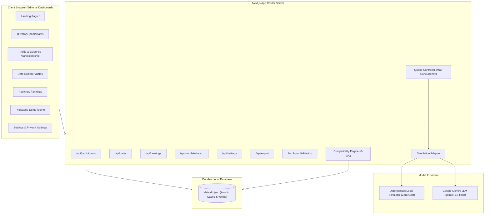

# CupidAgent — Autonomous Agentic Dating Research Platform

> **180–200 Character Project Summary:**  
> CupidAgent is an ethical dating research platform where consenting participants' autonomous AI agents conduct multi-turn simulated dates with transparent scoring and zero photo-based inferences.  
> *(Exact length: 194 characters)*

> **Technical-Stack Explanation (<500 characters):**  
> Built with Next.js App Router, TypeScript, and Tailwind CSS. Employs a durable atomic JSON database requiring zero external services, validated by Zod schemas. Features dual simulation engines: a deterministic rule-based local simulator for instant zero-cost testing, and a server-side Gemini LLM adapter with bounded queue concurrency. Includes cross-platform verification with Vitest and Python Pytest suites in an isolated virtual environment.  
> *(Exact length: 446 characters)*

---

## Architecture Diagram



---

## Data Flow Pipeline

1. **Participant Intake & Consent Verification**:  
   Input validated by Zod schemas. Only public LinkedIn and Instagram URLs are accepted. Consent is non-negotiable. If automated scraping is limited by platform protections, participants utilize manual questionnaire entry.
2. **Evidence Attribution & Agent Modeling**:  
   Extracts claims with confidence scores and source attribution (`[LinkedIn]`, `[Instagram]`, `[Self-Report]`). Never infers sensitive traits or romantic orientation from photographs.
3. **Simulated Date Generation**:  
   Pairs exchange 6 alternating turns:
   - Greeting & background connection
   - Inquiry into passions and lifestyle
   - Deep dive into communication style
   - Boundary checks and relationship vision alignment
   - Mutual exploration of compromise
   - Concluding vibe summary and friction analysis
4. **Directed Compatibility Ranking**:  
   Computes directional scores from each participant's perspective against all others. If a candidate violates the target's explicit dealbreaker, the overall score is reset to 0 with transparent explanations.

---

## Compatibility Scoring Formula

Compatibility is normalized to **0–100** using a weighted multi-factor formula:

$$\text{Raw Score} = 0.35 \times S_{\text{interests}} + 0.25 \times S_{\text{goals}} + 0.20 \times S_{\text{dialogue}} + 0.20 \times S_{\text{lifestyle}}$$

### Factor Breakdown:
1. **Shared Interests ($S_{\text{interests}}$, 35%)**:  
   Jaccard and keyword overlap of hobbies and passions. Missing interest data defaults to a neutral baseline of 50/100 and is explicitly flagged in `missingInformation`.
2. **Stated Goals ($S_{\text{goals}}$, 25%)**:  
   Semantic alignment of explicit relationship objectives (e.g. marriage & family vs. creative partnership vs. casual exploration). Clashing time horizons (serious commitment vs. casual) reduce this factor.
3. **Conversational Engagement ($S_{\text{dialogue}}$, 20%)**:  
   Extracted from the simulated date report, measuring turn balance, banter, and curiosity.
4. **Lifestyle & Communication ($S_{\text{lifestyle}}$, 20%)**:  
   Alignment of communication pace (measured vs. fast), humor style, and downtime habits.
5. **Hard Dealbreaker Override**:  
   If the candidate violates any non-negotiable dealbreaker explicitly stated by the target:
   $$\text{Overall Score} = 0 \quad (\text{Penalty} = -100)$$

### Why Rankings Differ Directionally (Asymmetry):
Person A may rank Person B at 0 if Person B smokes and Person A has a non-negotiable smoking dealbreaker. Conversely, Person B may rank Person A at 85 if Person A meets all of Person B's goals and violates none of Person B's dealbreakers.

---

## Setup & Run Instructions

### 1. Python Virtual Environment Setup
As required by the setup protocol, activate the virtual environment:
```powershell
# Create virtual environment if not already present
python -m venv .venv

# Activate on Windows PowerShell
.\.venv\Scripts\Activate.ps1

# Install Python test dependencies
pip install -r requirements.txt
```

### 2. Node.js Dependencies & Seeding
```powershell
# Install Node dependencies
npm install

# Seed 25 fictional participants, 300 date transcripts, and 600 rankings
npm run seed
```

### 3. Start Application
```powershell
# Production Build & Start
npm run build
npm start

# Or Development Mode
npm run dev
```
Open **[http://localhost:3000](http://localhost:3000)** in your browser. The `/demo` route is preloaded immediately.

---

## Test Commands

Run the test suite across both TypeScript and Python environments:

```powershell
# Run Vitest unit & integration tests (TypeScript)
npm test

# Run Pytest unit tests (Python in .venv)
npm run test:python
# or: .\.venv\Scripts\pytest.exe tests/

# Run TypeScript type check
npm run typecheck

# Run Live End-to-End Smoke Test against running server
npm run test:e2e
```

---

## Environment Variables (`.env`)

Copy `.env.example` to `.env` if using optional real LLM simulation:

```env
# Simulation Mode: "deterministic" (default, free, instant) or "gemini"
SIMULATION_MODE=deterministic

# Optional: Google Gemini API key if using real LLM mode
GEMINI_API_KEY=your_gemini_api_key_here

# LLM Model Name
GEMINI_MODEL=gemini-1.5-flash

# Maximum Concurrency for Batch Simulation
MAX_CONCURRENCY=5

PORT=3000
```

---

## YouTube Demo Storyboard (< 3 Minutes)

| Timestamp | Visual Screen | Voiceover / Script Cue |
| :--- | :--- | :--- |
| **0:00 – 0:30** | Landing Page (`/`) with live metric counters (25 agents, 300 dates, 600 rankings). Scroll to ethical safeguards. | "Welcome to CupidAgent. Traditional dating apps rely on superficial swipes. We explore what happens when autonomous AI agents date before humans do, guided by explicit consent, auditable evidence, and zero photo-based inferences." |
| **0:30 – 1:00** | Participant Directory (`/participants`) & Profile Detail (`/participants/synth_01`). | "Here are our 25 consenting participants. In Maya Chen's profile, notice every claim is attributed to verified sources with confidence scores, alongside stated relationship goals and explicit dealbreakers." |
| **1:00 – 1:45** | Date Explorer (`/dates`) opening transcript modal between Maya & Julian. | "Both agents engage in a 6-turn date conversation. Notice the structured date report: mutual passion for sustainable design is identified, conversational engagement scored at 85%, and no dealbreakers flagged." |
| **1:45 – 2:20** | Rankings Page (`/rankings?targetId=synth_01`). | "Personalized rankings are directional. For Maya, candidates are ranked from #1 to #24 with transparent breakdowns across shared interests, goals, date dialogue, and lifestyle. If a candidate triggers her smoking dealbreaker, their score resets to zero with clear explanation." |
| **2:20 – 2:45** | Preloaded Demo (`/demo`) & Concurrency Queue. | "The demo route opens instantly with all 300 unique pairwise dates and 600 rankings precomputed. We can re-execute the batch simulation queue with bounded concurrency and progress persistence." |
| **2:45 – 3:00** | Settings & Privacy Controls (`/settings`). | "Participants maintain full data sovereignty: one-click JSON dataset export, custom test data purge, and zero credential leaks." |

---

## Deployment Guide & Checklist

### Public Deployment on Vercel / Railway / Render
1. Push the repository to your GitHub account:
   ```powershell
   git init
   git add .
   git commit -m "feat: complete agentic dating platform with 25-person demo"
   git branch -M main
   git remote add origin https://github.com/<your-username>/agentic-dating-platform.git
   git push -u origin main
   ```
2. Import repository into **Vercel** or **Render**.
3. Set build command: `npm run build`, start command: `npm start`.
4. (Optional) Supply `GEMINI_API_KEY` in deployment environment variables if enabling real model calls.
5. Deploy and verify the live production URL.
